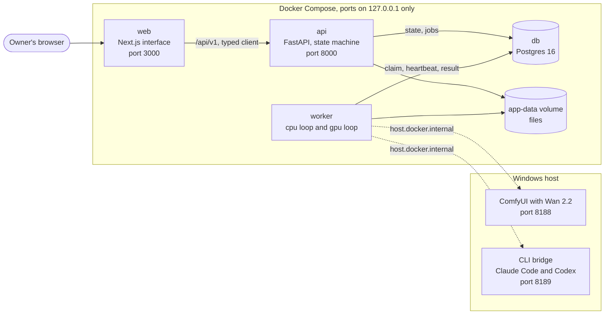
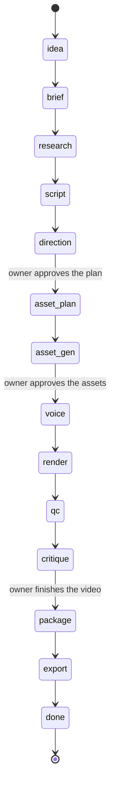
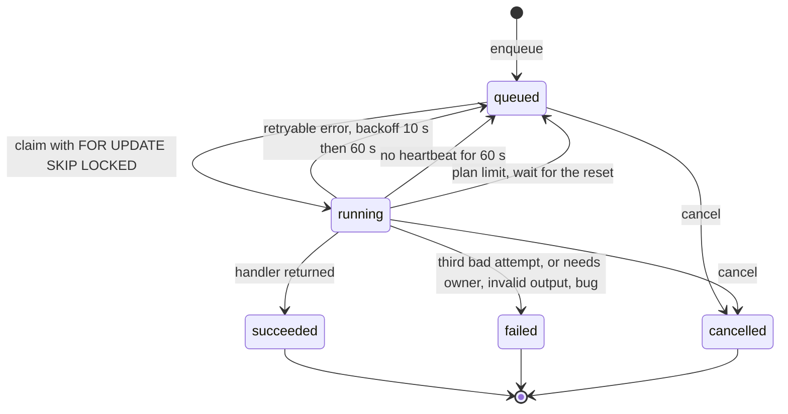

# Architecture

Video Factory Studio turns one idea into a finished short vertical video. A planning model
writes a machine-readable Episode Spec, generation tools make images, clips and narration,
and a deterministic render engine assembles the video from the spec. It runs on one PC and
is used in the browser at `http://localhost:3000`.

This document describes the system as it stands after milestone M0 (foundation) and marks
what later milestones add. The reasons behind the main choices are in the
[architecture decision records](adr/README.md).

## Components

Four services run in Docker Compose. Two tools run on the Windows host, outside Docker,
because they need the GPU or the owner's signed-in accounts.

| Component | Code | Responsibility | Exists after M0 |
| --- | --- | --- | --- |
| `web` | `apps/web` | The interface. Talks only to `api`, through the generated typed client | App shell, status strip, Board with the episodes, New episode dialog, episode workspace with the Plan tab, model picker, Usage page |
| `api` | `apps/api` | REST API under `/api/v1`, validation, pipeline state machine, enqueues jobs, serves files | Health endpoint, error shape, OpenAPI |
| `worker` | `apps/worker` | Claims jobs and runs them: planner calls, images, voice, render, QC, export, and the client side of ComfyUI | Job loops and a no-op job |
| `db` | Postgres 16 | All state: episodes, specs, assets, jobs, renders, reviews, usage | All 15 tables |
| ComfyUI | on the host | Wan 2.2 image-to-video inference, driven over HTTP by the worker | Reachability probe only (clip adapter in M3) |
| CLI bridge | `tools/cli_bridge`, on the host | Lets the worker use the owner's Claude and ChatGPT plans through the official command line tools | Not yet. Built in M2: `/health`, `/claude` and `/codex` on `127.0.0.1:8189` ([ADR 8](adr/0008-host-bridge-for-the-command-line-tools.md)) |

Shared code lives in `packages/`:

| Package | Holds | Rule |
| --- | --- | --- |
| `packages/core` | Database models, enums, job queue, settings, logging, storage interface | No web framework, no vendor SDK |
| `packages/adapters` | One adapter per external tool, each with a mock twin | The only place a vendor SDK may be imported |
| `packages/render` | Resolver, compositor, primitives, theme, audio, encode (M1) | No network access |
| `packages/skills` | Planner skills with schemas, examples and tests (M2) | One model call, one validated output |
| `packages/agents` | Agent runtime, critic and producer (M6, M7) | Limits enforced in the runtime, not in prompts |

## How a request flows

1. `web` calls `api` to create an episode from an idea.
2. `api` writes the new state and enqueues the job for that state.
3. `worker` claims the job, calls the adapter, writes files through the storage adapter and
   records the result and its cost.
4. `api` advances the state machine or stops at a gate that waits for the owner.
5. `web` polls the episode and its jobs every 2 seconds while jobs are active.

The browser talks to one origin only. Next.js forwards `/api/v1` to the API, so there is no
cross-origin setup and the API address never reaches the browser.

## Pipeline state machine

An episode moves through these states (design document section 4.1). A state advances only
when all of its jobs have succeeded. Three gates stop and wait for the owner. Any state can
be run again, which marks the later states out of date and deletes nothing. The state
machine itself is built in M2. The states already exist as `EpisodeState` in
`packages/core/enums.py`, and a test keeps this diagram in step with it.

| State | Jobs | Tag | Output |
| --- | --- | --- | --- |
| `idea` | none | | Idea text saved |
| `brief` | `plan.brief` | cpu | Angle, lesson, three titles |
| `research` | `plan.research` | cpu | Claims with opened sources |
| `script` | `plan.script` | cpu | Narration lines per scene |
| `direction` | `plan.direct` | cpu | Episode Spec draft. Gate: plan approval |
| `asset_plan` | `plan.assets` | cpu | Asset manifest and prompts |
| `asset_gen` | `gen.image`, then `gen.clip` | cpu, gpu | Images, then clips. Gate: asset approval |
| `voice` | `gen.voice` | cpu | One audio file per scene plus word timings |
| `render` | `render.scene` per scene, then `render.join` | cpu | Scene files, draft video, contact sheet |
| `qc` | `qc.run` | cpu | QC report |
| `critique` | `agent.critic` | cpu | Critic report, optional auto-fixed version. Gate: review (finish, adjust, remake) |
| `package` | `plan.package` | cpu | Title, description, hashtags, cover frame |
| `export` | `export.pack` | cpu | Export folder |
| `done` | | | Listed under Finished |

How an episode moves (`packages/core/pipeline.py`, rules of design section 4.2):

- **By itself between gates.** When the worker stores a job's result it tells the
  pipeline in the same transaction. Once every job of the state's current stage has
  succeeded, the next stage or the next state is queued. Nothing polls.
- **Gates.** After `direction`, `asset_gen` and `critique` the episode sets
  `awaiting_approval` and queues nothing. Approve enters the next state. Reject needs a
  comment and runs a state again with that comment: by default the state that produced
  what was rejected (the plan: `direction`, the assets: `asset_gen`, the video: `render`).
- **Re-run.** Any state the episode has reached can be run again. Jobs that were still
  waiting are cancelled, nothing is deleted, and `stale_from_state` names the first later
  state whose finished work is now out of date. The marker moves forward as those states
  are done again.
- **Stale scenes.** An edit of the spec after plan approval is compared with the version
  before it. Changed narration marks voice and render of that scene, a changed visual or
  asset marks its render, changed timing marks the render of that scene and every later
  one. The ids are kept in `episode.stale_scenes`, and the voice and render states then
  make only those scenes again.
- **Runs.** Every job the pipeline creates carries `state`, `stage` and `run` in its input.
  A state's current run is its highest run number.

## Job queue

Jobs live in the `job` table (ADR 2). The worker is one process with `CPU_WORKERS` threads
for cpu jobs, one thread for gpu jobs and one maintenance thread.

- Two workers never run the same job: claims use `SELECT ... FOR UPDATE SKIP LOCKED`.
- At most one gpu job runs at a time, across processes: gpu claims take an advisory lock
  and are refused while a gpu job is running.
- A running job sends a heartbeat every 10 seconds. A job that goes quiet for 60 seconds
  returns to the queue, which is how jobs survive a restart of any container.
- A claim is identified by the job's start time. A worker that was presumed dead cannot
  overwrite the result of the worker that replaced it.
- Jobs are idempotent: output paths come from a hash of the job's type and input, so a
  retry writes the same files.

## Provider modes

One setting, `PROVIDER_MODE`, decides how models are reached. It never changes by itself
and there is no fallback to a paid service.

| Mode | Language models | Images | Cost |
| --- | --- | --- | --- |
| `demo` (default) | Recorded responses | Bundled samples | None |
| `subscription` | Claude Code CLI and Codex CLI through the host bridge | Codex CLI image tool, owner upload as fallback | Covered by the owner's plans |
| `api` | Anthropic and OpenAI APIs with keys | OpenAI image API | Pay per use, only with the Settings switch on as well |

Everything in `demo` mode works with no keys, no GPU and no accounts. CI runs in it.

Paid APIs need two things together: `PROVIDER_MODE=api` and the owner's "Use paid APIs"
switch, which is kept in the `setting` table and changed with `PUT /settings`. Every paid
adapter builds on `PaidApiAdapter` (`packages/adapters/paid.py`), whose constructor
refuses without both and says which is missing. A paid adapter that was not switched on
does not exist, so it cannot call anything. Each model call is stored with its billing
type (`demo`, `plan` or `api`), and the database refuses a record whose billing type does
not match its provider, or a plan or demo call that carries a cost.

## Where the rules are enforced

| Rule | Enforced by |
| --- | --- |
| Services bind to 127.0.0.1 (NFR-02) | `docker-compose.yml`, checked by `tests/infra/test_compose.py` |
| The provider mode never changes by itself (FR-28) | Frozen settings, and source scans in `tests/infra/test_provider_mode.py`: no code sets the mode or writes the environment |
| No paid API without mode and switch (FR-28) | `PaidApiAdapter`, and a scan that fails when a module imports a paid SDK without it |
| Billing type on every model call (FR-29) | CHECK constraints on `model_call` and `provider_usage` (migration 0003) |
| No secrets in the repository (rule 1) | gitleaks pre-commit hook and the `secret-scan` CI job |
| No secrets in logs or responses (NFR-01) | `packages/core/logs.py` redaction, generic 500 responses, tests |
| Every asset has a licence row (rule 2) | `scripts/check_assets.py`, pre-commit hook and the `asset-licence` CI job |
| API and typed client agree | `apps/api/tests/test_contract.py` and `pnpm --filter web check:api` |
| Models match the database | "autogenerate shows no diff" integration test |
| One gpu job at a time (D8) | `packages/core/queue.py`, concurrency tests on real Postgres |
| Responsive and accessible interface (UX-01 to UX-07) | Playwright and axe in `apps/web/e2e` |
| 80 percent line coverage (NFR-04) | `make coverage`, the `integration` CI job |

## Data

The schema is in `packages/core/db/models.py` and the migrations in
`packages/core/db/migrations`. Fixed value sets are text columns with CHECK constraints,
money is exact decimal, timestamps carry a time zone, and no foreign key cascades a delete:
nothing is deleted in v1. Files are reached only through the storage adapter, which in v1
is a folder on the `app-data` volume.

## Not in v1

Multi-user accounts, cloud deployment, any automatic posting or upload, analytics, a second
theme and a timeline editor are out of scope. The job tags and the storage adapter are the
seams that would let a later version move the worker's GPU work to another machine.
